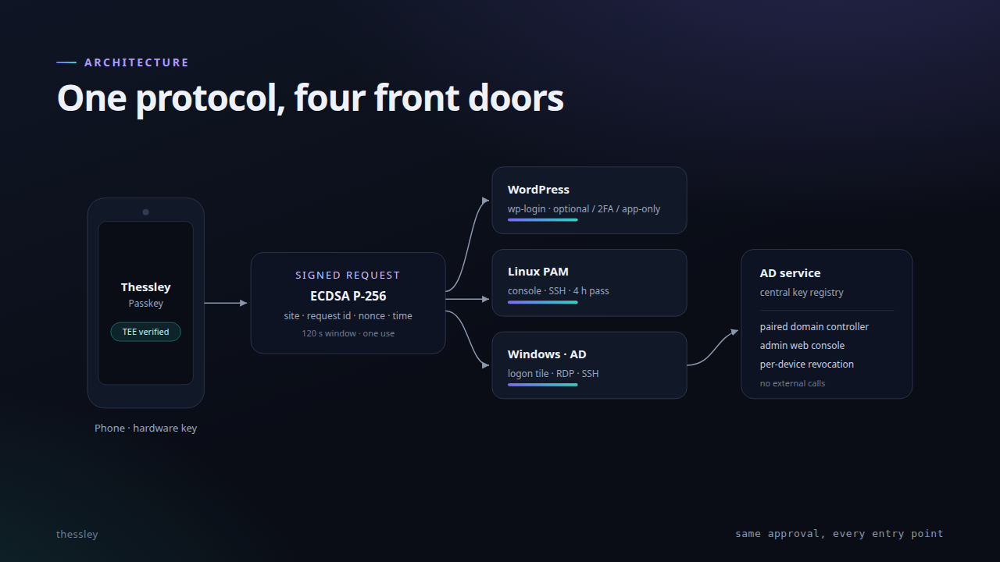

# Thessley

  

Passwordless authentication for WordPress, Linux, Windows and Active Directory — plus the security-hardening plugins and infrastructure behind it.

**Full deck:** [13 slides on GitHub Pages](https://netmate1234.github.io/Thessley/) (arrow keys, or click the edges).

## The problem

- **Passwords travel.** Typed into the wrong window, reused across sites, stored where the site can read them. One leak is enough.
- **Phishing works**, and a second factor typed into the same page goes with it.
- **Nobody can tell you why.** “Someone logged in as admin” is usually all the audit trail says.

## The idea

Put the key on the phone and ask the person.

- **Possession:** an EC P-256 key generated in secure hardware and never exported.
- **Approval:** each sign-in is one visible request, confirmed with the device’s own unlock.
- **Origin-bound:** the signed message names the site, so a relayed QR is self-evidently for the wrong one.
- **No shared secret:** the server stores a public key, never anything replayable.

## How it works

1. The site mints a one-time request: id, nonce, origin, 120-second life.
2. The QR — or a tap on the same phone — hands it to the app.
3. The app shows the site and account; the phone’s lock authorises the signature.
4. The server verifies the signature against the enrolled key and the origin.
5. The browser that started the request gets the session; the request is consumed.

## Products

| Project | What it does |
|---|---|
| **[Passkey (WordPress)](https://github.com/netmate1234/thessley-passkey)** | QR or one-tap sign-in for `wp-login.php`: optional, password-then-app, or app-only. Per-user device list, attestation, revocation. |
| **[PAM for Linux](https://github.com/netmate1234/thessley-pam-linux)** | `sudo`, GNOME login and lock, SSH, keyring, admin web and VPN — approved from the phone. One approval covers 4 hours per user, service and address. |
| **[PAM for Windows](https://github.com/netmate1234/thessley-pam-windows)** | Windows OpenSSH has no PAM, so a `ForceCommand` gate plus a SYSTEM service run the same protocol after the password. |
| **[Passkey for Linux](https://github.com/netmate1234/thessley-passkey-linux)** | The desktop approver: TPM, FIDO2 or PIN, for any Thessley site. |
| **[Passkey server](https://github.com/netmate1234/thessley-passkey-server)** | The PHP protocol: WordPress reference implementation and a standalone Drupal module. |
| **[Security Hardening](https://github.com/netmate1234/thessley-security-hardening)** | Twenty-odd WordPress modules with one Event Log: perimeter, request inspection, detection, hardening, alerts. |

## Security model

| On the phone | On the server |
|---|---|
| Private key in Android Keystore / TPM, never exported | Public key, label, last-used time, attestation verdict |
| Signature requires the device lock | No shared secret, no replayable token |
| Attestation proves TEE, StrongBox or TPM where present | Origin is checked; a relayed QR cannot verify |

## Operations

- One command installs the Windows tile, hides the password provider, gates SSH and sets RDP and logon rights — with a timed rollback and a `-Keep` switch when you mean it.
- Every step is reversible; nothing phones home; QR codes are generated locally.
- Tested: behavioural suites, HTTP end-to-end with real EC signatures, Plugin Check 0/0. WordPress 6.0+, PHP 8.3.

Security hardening and Thessley authentication tools for the sites and hosts managed by this project.

The root-only OPI5 helper for enrolling Thessley devices on the supported WordPress and Drupal sites is documented in [the enrollment guide](docs/opi5-thessley-web-enrollment.md).