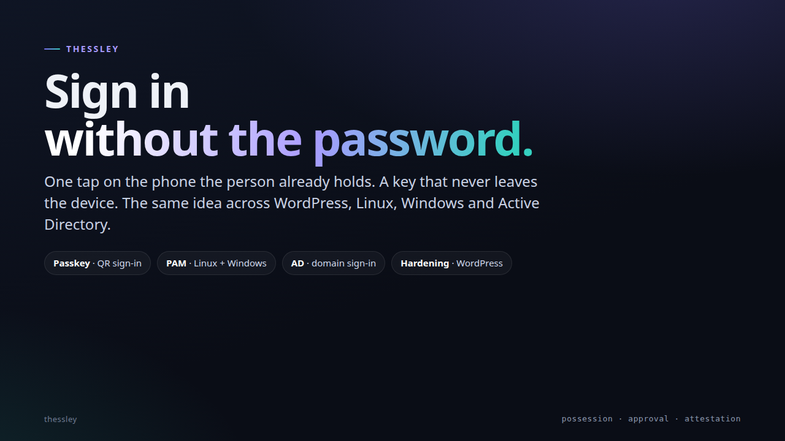
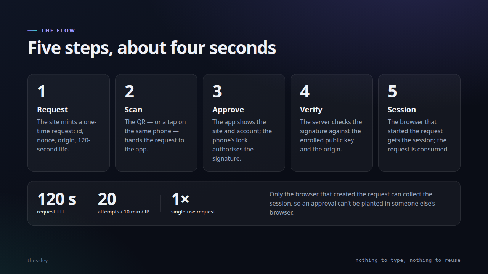

# Thessley

**Interactive deck:** [netmate1234.github.io/thessley-presentations/thessley](https://netmate1234.github.io/thessley-presentations/thessley/) — 13 slides, arrow keys or click the edges.

| Architecture | The approval flow |
|:---:|:---:|
|  |  |

Security hardening and Thessley authentication tools for the sites and hosts managed by this project.

The root-only OPI5 helper for enrolling Thessley devices on the supported WordPress and Drupal sites is documented in [the enrollment guide](docs/opi5-thessley-web-enrollment.md).